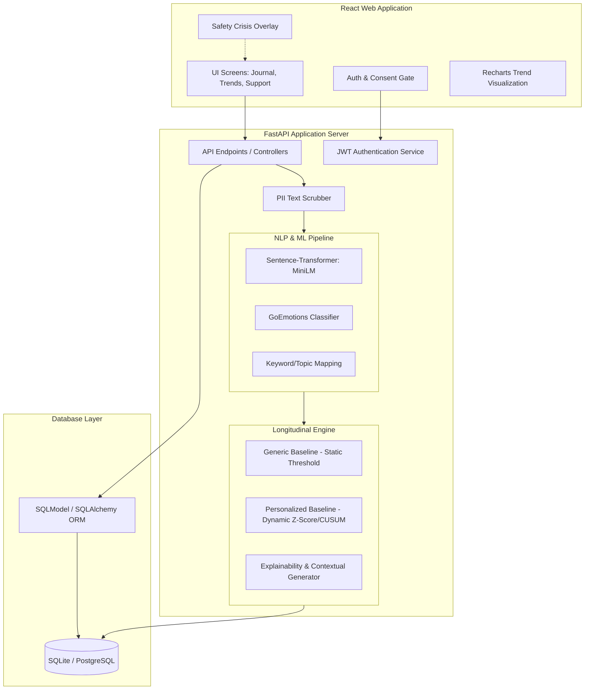

# MindTrace System Architecture

This document describes the end-to-end technical architecture, system components, machine learning pipeline, statistical models, and privacy boundaries for the MindTrace personalized wellness monitoring system.

---

## 1. High-Level Architecture Diagram



---

## 2. Component Descriptions

### 2.1. Frontend (React + Vite)
*   **Routing & Navigation:** `react-router-dom` for structured, client-side routing.
*   **State Management & API:** Standard React hooks (`useState`, `useEffect`, `useContext`) paired with Axios for asynchronous requests.
*   **UI System & Calm Design:** Tailwind CSS for a minimal, clean, accessible UI using a soft color scheme (sage greens, slate blues, off-whites) to minimize cognitive load.
*   **Visualization:** `recharts` for rendering multi-series trend charts, showing daily check-in values and NLP-derived signal trends without overwhelming numerical statistics.

### 2.2. Backend (FastAPI + Uvicorn)
*   **API Framework:** FastAPI for asynchronous execution, automatic OpenAPI documentation, and typed validation using Pydantic.
*   **Authentication:** JWT session tokens stored in HTTP-only cookies or authorization headers. Password hashing using `passlib` with `bcrypt`.
*   **Security Scrubber:** Intercepts journal text to strip common personally identifiable information (PII) like email addresses, phone numbers, and names using regex patterns prior to analysis.

### 2.3. Database (Dual Mode SQLModel)
*   **ORM:** `SQLModel` (combines SQLAlchemy and Pydantic) to ensure data-integrity from API payload to SQL database row.
*   **Dual Mode Database Adapter:**
    *   *Development:* SQLite (`sqlite+aiosqlite:///mindtrace.db`) for immediate local setup with zero external dependencies.
    *   *Production/Staging:* PostgreSQL (`postgresql+asyncpg://`) for enterprise-grade scalability and robust concurrency.

---

## 3. NLP & Machine Learning Pipeline

The NLP pipeline converts raw text into structured numerical signals in a fully local, privacy-preserving manner:

```
[Raw Journal Entry] ──> [PII Scrubber] ──> [MiniLM Embedding] ──> [GoEmotions / Topic Classifier] ──> [Wellness Signals [0, 1]]
```

1.  **PII Scrubbing:** Text is preprocessed to remove phone numbers, email addresses, and names.
2.  **Dense Embedding Extraction:**
    *   Model: `sentence-transformers/all-MiniLM-L6-v2` (384 dimensions).
    *   Rationale: Runs efficiently on single-core CPUs (~50ms inference time), is highly reproducible, and provides excellent semantic similarity clustering.
3.  **Signal Classification:**
    *   A local PyTorch or Scikit-learn multi-label classifier (trained on the GoEmotions dataset) converts the 384-dimensional embedding into probability scores $[0.0, 1.0]$ across specific categories:
        *   *Emotions:* Joy, Sadness, Anger, Fear, Surprise.
        *   *Topics:* Work/Academic Pressure, Sleep Concerns, Social Connection, Fatigue.
    *   *Note:* No external APIs are called; all model inference is executed locally in python.

---

## 4. Longitudinal Change Detection Engine

The engine runs two models side-by-side to power the research comparison:

### 4.1. Model A: Generic Population Baseline
*   **Mechanism:** Employs static thresholds derived from the validation set.
*   **Decision Rule:** Flags a deviation if a signal $X_t$ exceeds a fixed threshold $T_{\text{static}}$ (e.g., $X_{\text{stress}} > 0.75$) for $k$ consecutive days (default: $k = 3$).
*   **Limitation:** Fails to account for high-stress individuals who function normally under pressure (leads to false positives) or low-expression individuals whose subtle distress goes undetected (leads to false negatives).

### 4.2. Model B: Personalized Individual Baseline
*   **Mechanism:** Learns user-specific normal distributions of signals over a rolling historical window $W$ (default: $W = 14$ entries).
*   **Decision Rule 1 (Dynamic Z-Score):**
    Calculate rolling mean ($\mu_t$) and standard deviation ($\sigma_t$) for the historical window:
    $$\mu_{t-1} = \frac{1}{W} \sum_{i=1}^{W} X_{t-i}, \quad \sigma_{t-1} = \sqrt{\frac{1}{W} \sum_{i=1}^{W} (X_{t-i} - \mu_{t-1})^2}$$
    Flag a deviation at day $t$ if the current signal $X_t$ satisfies:
    $$X_t > \mu_{t-1} + Z_{\text{thresh}} \cdot \sigma_{t-1}$$
    (where $Z_{\text{thresh}}$ is a tuneable parameter, e.g., $Z_{\text{thresh}} = 1.96$ for a $95\%$ confidence interval).
*   **Decision Rule 2 (CUSUM - Cumulative Sum):**
    Used to detect small, persistent shifts in the mean of a signal.
    $$S_t^+ = \max(0, S_{t-1}^+ + X_t - (\mu_{t-1} + K))$$
    Where $K$ is the allowable slack parameter ($K = 0.5 \sigma_{t-1}$). Flags a deviation if $S_t^+ > H$ (decision interval, e.g., $H = 4 \sigma_{t-1}$).

---

## 5. Explainability Layer

To satisfy the safety and usability boundaries, the explainability layer is deterministic and rule-based rather than generative.

*   **Rule:** An explanation is generated by referencing the specific mathematical components that triggered the deviation.
*   **Example Text Compilation:**
    *   *System Flags:* Work/Academic Pressure deviation ($Z = 2.4$).
    *   *Template Output:* "Over the last 3 days, work-related mentions in your journal were significantly higher ($+2.4\sigma$) than your 14-day average. You also reported 'neutral' or 'difficult' sleep during check-ins."
    *   *Self-Reflection Prompt:* "Has your current workload been impacting your sleep routine lately?"

---

## 6. Privacy & Safety Boundaries

### 6.1. Privacy by Design
*   **No Raw Text Logs:** Log files must never record the raw string of the journal entry. Logs can print event metadata, e.g., `[INFO] Processed journal ID 4821 for User 920. Sentiment score: 0.82`.
*   **Anonymization:** User records use UUIDs. Journal entries are stored alongside these UUIDs.
*   **Researcher View Limitation:** The researcher dashboard queries only aggregate tables (averages, counts, false-alarm rates, F1 scores) and is prohibited from displaying specific journal entry records.

### 6.2. Safety Gateway
*   **Trigger Mechanism:** Deterministic, high-recall regex pattern matching for clinical risk vocabulary (e.g., suicide, self-harm, despair phrases) executed on the frontend and backend.
*   **Action:** Displays a clear modal overlay with regional helpline contacts, emergency numbers, and a pre-configured quick-text contact link for their designated trusted contact. It does *not* record a diagnosis or transmit data automatically to authorities.
